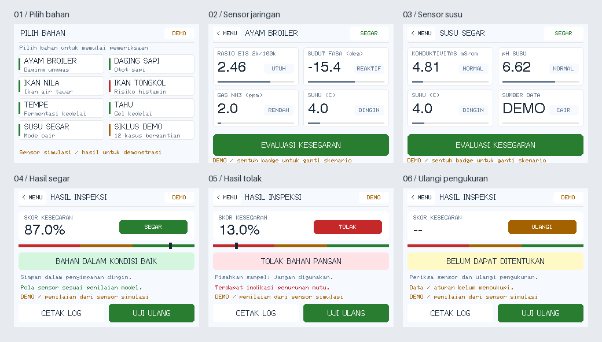

# Fuzzylogic TFT

An Indonesian MBG food freshness research prototype with Python and C99 fuzzy inference engines and a light touchscreen interface. It supports seven ingredient profiles: chicken, beef, freshwater fish, tongkol, tempeh, tofu, and fresh milk.

The display firmware runs on **GUITION JC2432W328C (ESP32-D0WD-V3)** or a separately wired ESP32-S3. It provides ingredient selection, simulated sensor cards, verdicts, retesting, and Serial inspection receipts. The current UI uses **simulated sensor readings**, marked DEMO on screen; connecting and calibrating physical sensors is separate work. Missing or invalid measurements produce an indeterminate result.



## GUITION board quick start

Install Arduino CLI, ESP32 Arduino core **2.0.17**, and TFT_eSPI **2.5.43** (the versions verified on hardware). With the ESP32 core package index configured:

```bash
arduino-cli core install esp32:esp32@2.0.17
arduino-cli lib install 'TFT_eSPI@2.5.43'
./scripts/build_tft.sh --board guition
arduino-cli board list
```

Upload to the port reported for your board (here `/dev/ttyUSB0`):

```bash
arduino-cli upload --port /dev/ttyUSB0 --fqbn esp32:esp32:esp32 \
  --input-dir bin/tft-guition-ili9341 firmware/esp32s3_mbg_display
arduino-cli monitor --port /dev/ttyUSB0 --config baudrate=115200
```

The build script supplies the driver and pins to both the sketch and TFT_eSPI without changing the library's global setup. GUITION uses capacitive CST820/816 touch and does not need resistive touch calibration. See the [GUITION pin map](docs/guition-jc2432w328c.md) and [display firmware guide](firmware/esp32s3_mbg_display/README.md) for wiring, Serial commands, and alternative controllers.

For the separately wired ESP32-S3 configuration, run `./scripts/build_tft.sh` and upload with FQBN `esp32:esp32:esp32s3` using `bin/tft-ili9341`. Its pin map differs from GUITION.

## Host development

Use Python 3.10+, Make, and GCC/G++ with C99 and C++17 support:

```bash
python3 -m venv .venv
source .venv/bin/activate
python -m pip install -r requirements.txt
make test PYTHON=python
./bin/mbg_inspect
python scripts/preview_tft.py
```

The preview script reads bitmap fonts from an installed TFT_eSPI library. Use `--tft-library /path/to/TFT_eSPI` if it is outside `~/Arduino/libraries`.

The test suite covers inference boundaries, invalid inputs, Python/C agreement, touch navigation on both board configurations, capacitive coordinates, calibration behavior, text placement, and inspection snapshots.

## Project contents

- `firmware/esp32s3_mbg_display/`: shared light UI, GUITION/S3 board configurations, and sensor simulation.
- `firmware/src/`: portable C99 inference, ingredient profiles, and calibration helpers.
- `firmware/esp32s3_mbg_inspector/`: separate ESP32-S3 inspection sketch.
- `fuzzy_model.py`, `feature_processing.py`, `membership_functions.py`: Python model and feature extraction.
- `tests/`: C, Python, and firmware host regression tests.
- Numbered research documents and figure folders: model rationale, sources, and validation planning. Start with the [research summary](01_RESEARCH_SUMMARY.md) and [software documentation](13_FUZZY_MODEL_README.md).

## Verified hardware

On 2026-10-07, the GUITION build was uploaded using Arduino CLI, started successfully, and detected the CST controller at I2C address `0x15`. Serial-driven fresh and spoiled chicken simulations produced scores of 86.9 and 13.0 respectively. All 93 host tests passed. Actual touch alignment and physical sensor readings still require hands-on validation.
